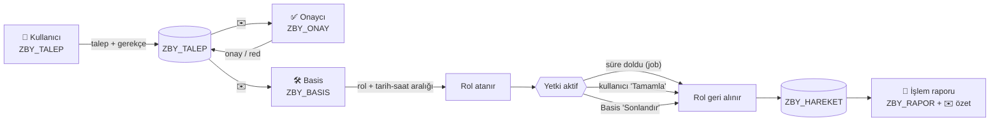
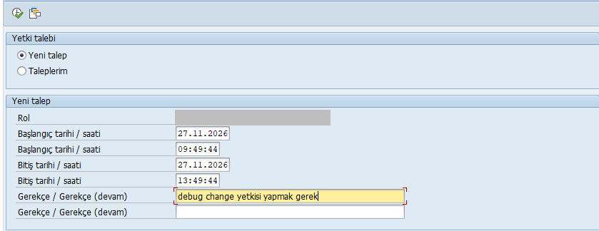
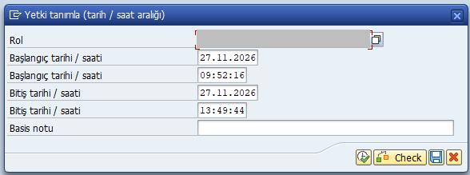
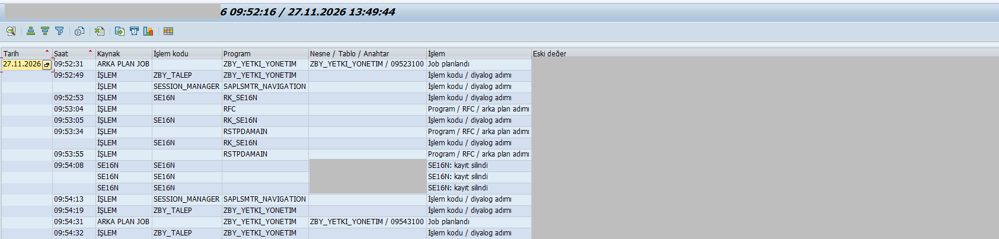

# ZBY – SAP Süreli Yetki Yönetimi (Firefighter / Emergency Access)


SAP sistemlerinde **kritik yetkinin kısa süreli, onaylı ve izlenebilir** şekilde verilmesini sağlayan, tamamen ABAP ile yazılmış bağımsız bir çözüm.

Kullanıcı yetki talep eder, onaycı onaylar, Basis ekibi kesin tarih-saat aralığını tanımlar. Program rolü atar, süre dolunca (veya kullanıcı işini bitirince) rolü geri alır. Yetkili olunan süre boyunca **kullanıcının sistemde yaptığı her şey** yedi farklı standart SAP kaynağından toplanıp tek bir rapor ve e-posta olarak ilgililere iletilir.

> **EN –** A standalone ABAP solution for time-boxed emergency ("firefighter") access in SAP. Request → approval → Basis grants a role for an exact date/time window (max 24 h) → the role is revoked automatically → every activity the user performed during the window (transactions, change documents, table logs, SE16N edits, jobs, transports, Security Audit Log) is collected into a permanent report and e-mailed to stakeholders. No third-party GRC product required.

---

## Neden?

Üretim sistemlerinde arıza, ay sonu kapanışı veya acil düzeltme gibi durumlarda kullanıcılara geçici olarak geniş yetki vermek gerekir. Bu yetki çoğu zaman:

* e-posta / telefonla istenir, kayıt altına alınmaz,
* verildikten sonra **geri alınması unutulur**,
* kullanıcının o sürede ne yaptığı denetimde **gösterilemez**.

SAP GRC Firefighter veya üçüncü parti ürünler bu ihtiyacı karşılar ama lisans ve kurulum maliyeti yüksektir. **ZBY**, aynı temel kontrolü tek bir ABAP programı ve birkaç Z tablosuyla sağlar.

## Özellikler

| | |
|---|---|
| 🔐 **Uçtan uca süreç** | Talep → Onay → Basis tanımlama → Otomatik aktifleştirme → Otomatik geri alma → Rapor |
| 👀 **4 göz ilkesi** | Kullanıcı kendi talebini onaylayamaz, Basis kendine yetki tanımlayamaz |
| ⏱ **Süre sınırı** | En fazla 24 saat; parametreyle daha da kısaltılabilir. Saat/dakika hassasiyetinde geri alma |
| 🔢 **Otomatik numara** | Her talebe sıralı talep / ticket numarası verilir |
| 📊 **7 kaynaktan işlem raporu** | STAD (işlem kodları), değişiklik belgeleri, tablo logu, SE16N, arka plan job'ları, transportlar, Security Audit Log |
| 💾 **Kalıcı kayıt** | Hareketler `ZBY_HAREKET` tablosuna yazılır; STAD silinse bile aylar sonra rapor açılabilir |
| ✉️ **E-posta bildirimleri** | Her adımda ilgililere düzenli HTML e-posta, bitişte özet rapor |
| 🧾 **Denetim izi** | Her adım ve raporu kimin açtığı `ZBY_LOG` tablosunda |
| ⚙️ **Kod değişmeden ayar** | Rol, süre, açık kaynaklar, e-posta ayarları ve kullanıcılar SM30 tablolarından yönetilir |

## Nasıl çalışır?



| Durum | Anlamı |
|---|---|
| `N` | Onay bekliyor |
| `O` | Onaylandı, Basis bekliyor |
| `P` | Planlandı (başlangıç zamanı bekleniyor) |
| `A` | Yetki aktif |
| `T` / `E` / `S` | Kullanıcı tamamladı / Süre doldu / Basis sonlandırdı |
| `R` / `C` | Reddedildi / İptal edildi |

## Kullanım

| İşlem kodu | Kim kullanır | Ne yapar |
|---|---|---|
| `ZBY_TALEP` | Tüm kullanıcılar | **Yeni talep:** başlangıç-bitiş tarih/saati ve gerekçe girilir. **Taleplerim:** talebi izleme, ✅ *Süreci tamamla*, 🗑 iptal, 📄 rapor |
| `ZBY_ONAY` | Onaycılar | Bekleyen talepleri ✔ onaylar / ✖ reddeder (red gerekçesi zorunlu) |
| `ZBY_BASIS` | Basis ekibi | ✏ Rol ve kesin aralığı tanımlar, ⛔ erken sonlandırır |
| `ZBY_RAPOR` | Onaycı / Basis / Denetçi | Tüm taleplerin işlem raporu (kullanıcı yalnızca kendi raporunu görür) |
| Job (SM36) | Sistem | 5–15 dakikada bir: planlananları aktif eder, süresi dolanları geri alır, hareketleri toplar |

**Örnek senaryo**

1. Ayşe, ay sonu kapanışında bir düzeltme için `ZBY_TALEP`'ten bugün 14:00–16:00 için yetki ister. Talep no **12** verilir, onaycıya e-posta gider.
2. Onaycı `ZBY_ONAY`'dan onaylar; Basis ekibine e-posta gider.
3. Basis `ZBY_BASIS`'ten aralığı onaylar; saat 14:00'te rol Ayşe'ye atanır.
4. Ayşe işini 15:10'da bitirip **Süreci tamamla**'ya basar. Rol hemen geri alınır, rapor ekranda açılır.
5. Ayşe, onaycı ve Basis'e özet e-posta gider: hangi işlem kodlarını çalıştırdığı, hangi tablolarda neyi değiştirdiği, kaç hareket olduğu.

## Raporlanan kaynaklar

| Rapordaki adı | Standart SAP kaynağı | Ne gösterir |
|---|---|---|
| İŞLEM | STAD – `SWNC_STAD_READ_STATRECS` | Çalıştırılan işlem kodları ve programlar |
| DEĞ.BELGESİ | CDHDR / CDPOS | Ana veri, kullanıcı, rol değişiklikleri – eski / yeni değer |
| TABLO LOG | DBTABLOG | SM30 / customizing tablo değişiklikleri |
| SE16N | SE16N_CD_KEY / SE16N_CD_DATA | SE16N ile eklenen / değiştirilen / silinen kayıtlar |
| ARKA PLAN JOB | TBTCO / TBTCP | Planlanan ve çalışan job'lar |
| TRANSPORT | E070 / E07T | Oluşturulan / serbest bırakılan transportlar |
| AUDIT LOG | `RSAU_SELECT_EVENTS` (SM20) | Oturum, RFC, işlem başlatma, kullanıcı yönetimi olayları |

Her kaynak `ZBY_PARAM` tablosundan ayrı ayrı açılıp kapatılabilir.

## Proje yapısı

```
ZBY_YETKI/
├── README.md                   ← bu dosya
├── LICENSE                     ← MIT lisansı
├── ZBY_YETKI_YONETIM.abap      ← ana program (tüm süreç, ~2.900 satır)
├── ZBY_DDIC_KURULUM.abap       ← DDIC nesnelerini otomatik oluşturan kurulum programı
└── docs/
    ├── KULLANIM_KILAVUZU.md    ← ekran görüntüleriyle adım adım akış
    ├── TEKNIK_DOKUMAN.md       ← tablolar, parametreler, kurulum, yetkiler, test senaryosu
    ├── KOD_ACIKLAMASI.md       ← sınıflar, akış ve tasarım kararları
    └── images/                 ← ekran görüntüleri
```

## Hızlı kurulum

1. **DDIC:** `ZBY_DDIC_KURULUM` programını SE38'de oluşturup çalıştırın. Domain, veri elemanı ve 5 tabloyu (`ZBY_TALEP`, `ZBY_HAREKET`, `ZBY_KULLANICI`, `ZBY_PARAM`, `ZBY_LOG`) oluşturur ve varsayılan parametreleri yazar. İsterseniz [Teknik Doküman](docs/TEKNIK_DOKUMAN.md#3-ddic-nesneleri-se11)'a göre elle de oluşturabilirsiniz.
2. **Program:** `ZBY_YETKI_YONETIM`'i SE38'de oluşturup kodu yapıştırın, seçim metinlerini girin, aktive edin.
3. **İşlem kodları:** SE93'te `ZBY_TALEP`, `ZBY_ONAY`, `ZBY_BASIS`, `ZBY_RAPOR` (hepsi aynı programın 1000 ekranı). Program, modunu işlem kodundan anlar.
4. **Kullanıcılar:** SM30 → `ZBY_KULLANICI`: onaycı (`O`), Basis (`B`), denetçi (`D`).
5. **Job:** SM36'da "Arka plan job" varyantıyla 5–15 dakikada bir.
6. **E-posta:** SCOT'ta SMTP yapılandırılmış olmalı.

Ayrıntılar, yetki listesi ve test senaryosu: **[docs/TEKNIK_DOKUMAN.md](docs/TEKNIK_DOKUMAN.md)**

## Gereksinimler ve uyarlama

* **ABAP 7.40 SP08** veya üzeri (string şablonları, `VALUE #( )`, `xsdbool`). Kod klasik editörün 72 karakter sınırına uygundur.
* Kullanılan standart nesneler: `BAPI_USER_GET_DETAIL`, `BAPI_USER_ACTGROUPS_ASSIGN`, `SWNC_STAD_READ_STATRECS`, `CHANGEDOCUMENT_READ_RANGES`, `RSAU_SELECT_EVENTS`, `CL_SALV_TABLE`, `CL_SALV_BS_RUNTIME_INFO`.
* **E-posta:** Standart `CL_BCS` ile HTML e-posta gönderilir; SCOT'ta SMTP yapılandırılmış olması yeterlidir. Gönderen adresi `ZBY_PARAM-MAIL_GONDEREN` ile belirlenir (boşsa SAP varsayılanı).
* **Rol:** Varsayılan rol adı `Z_SURELI_YETKI`'dir. Kendi acil yetki rolünüzü PFCG'de oluşturup `ZBY_PARAM-ROL`'e yazın.
* CUA kullanılan sistemlerde rol ataması merkezi sistemden yapıldığı için uyarlama gerekir.

## Bilinen sınırlamalar

* Tek sistem / istemci için çalışır; çok sistemli kullanım için her sisteme kurulmalıdır.
* SAP rol ataması gün bazındadır; saat bazında başlatma ve bitirme job sıklığına bağlıdır.
* STAD verisi kısa süre saklanır; job düzenli çalışmazsa en eski işlem adımları kaybolabilir.

Tam liste: [Teknik Doküman – Bilinen sınırlamalar](docs/TEKNIK_DOKUMAN.md#6-bilinen-sınırlamalar)

## Ekran görüntüleri

Adım adım akış için: **[Ekran görüntüleriyle kullanım kılavuzu](docs/KULLANIM_KILAVUZU.md)**

| Yeni talep | Basis tanımlama |
|---|---|
|  |  |

**Hareket raporu** – yetki süresince yapılan her işlem, SE16N ile silinen kayıtlar dahil:



## Lisans

[MIT](LICENSE). Kodu kendi sistemlerinizde kullanmadan önce bir test sisteminde deneyin; rol atama ve geri alma kullanıcı yetkilerini doğrudan değiştirir.
