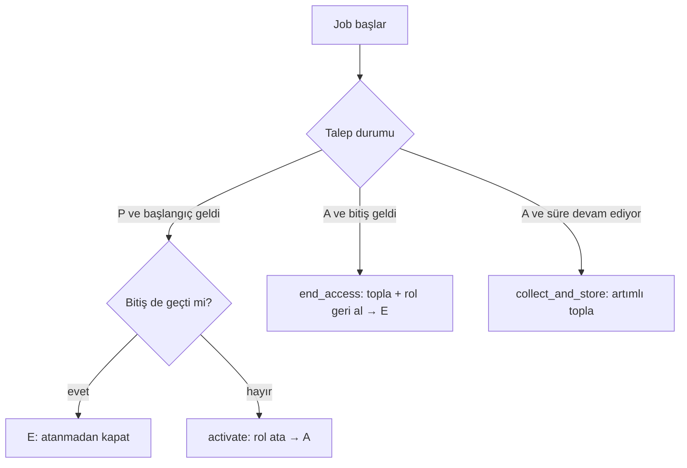

# ZBY – Kod Açıklaması

> Proje özeti: [README](../README.md) · Tablolar ve kurulum: [Teknik Doküman](TEKNIK_DOKUMAN.md)

Bu doküman `ZBY_YETKI_YONETIM` programının iç yapısını, sınıfların görevlerini ve önemli tasarım kararlarını anlatır. Kodu okuyacak, uyarlayacak veya geliştirecek ABAP geliştiricileri için yazılmıştır.

## 1. Genel bakış

Program tek bir rapor (`REPORT`) içinde yerel sınıflarla yazılmıştır. Ayrı global sınıf, fonksiyon grubu veya ekran (dynpro) yoktur; böylece tek bir kopyala-yapıştır ile taşınabilir.

```
ZBY_YETKI_YONETIM
├── Tipler ve sabitler        (durum kodları, mod kodları, kullanıcı tipleri)
├── Seçim ekranları           (1000 ana ekran, 9100 Basis popup, 9200 not popup)
├── lcl_cfg        ── ZBY_PARAM / ZBY_KULLANICI okuma, ayarlar
├── lcl_db         ── numara, log, zaman damgası yardımcıları
├── lcl_role       ── rol atama / geri alma (BAPI)
├── lcl_mail       ── e-posta gövdesi ve gönderim
├── lcl_collector  ── 7 kaynaktan kullanıcı hareketlerini toplama
├── lcl_app        ── süreç: talep, onay, tanımlama, bitiş, rapor, job
├── lcl_mode       ── hangi modda çalışılacağını belirleme
└── Olaylar        (INITIALIZATION, AT SELECTION-SCREEN, START-OF-SELECTION)
```

## 2. Çalışma modları

Aynı program beş farklı ekran gibi davranır. Mod iki yoldan belirlenir:

1. **İşlem kodu** (`INITIALIZATION`): `ZBY_TALEP`, `ZBY_ONAY`, `ZBY_BASIS`, `ZBY_RAPOR` ile açılırsa mod sabitlenir ve mod seçimi ekrandan gizlenir.
2. **Radyo butonları**: Program SE38'den doğrudan çalıştırılırsa kullanıcı modu kendisi seçer.

Arka planda (`sy-batch = X`) program **her zaman job modunda** çalışır.

| Mod | Ne yapar | Giriş noktası |
|---|---|---|
| Talep | Yeni talep oluşturur | `lcl_app->create_request` |
| Taleplerim | Kullanıcının kendi talepleri | `lcl_app->show_list` |
| Onay | Onay bekleyenler | `lcl_app->show_list` |
| Basis | Tanımlama / sonlandırma | `lcl_app->show_list` |
| Rapor | Tüm talepler ve raporlar | `lcl_app->show_list` |
| Job | Zamanlanmış işler | `lcl_app->run_job` |

`AT SELECTION-SCREEN OUTPUT`, `MODIF ID` grupları (`TLP`, `LST`, `JOB` …) ile yalnızca o moda ait alanları gösterir.

## 3. Sınıflar

### 3.1 `lcl_cfg` – Konfigürasyon

* `ZBY_PARAM` ve `ZBY_KULLANICI` tablolarını **bir kez** okuyup bellekte tutar (`load`).
* `param( iv_name iv_default )`: Parametre değerini döner; kayıt yoksa koddaki varsayılanı kullanır. Bu sayede tablolar boşken de program çalışır.
* `flag( )`: `X` / boş parametreleri `abap_bool`'a çevirir (kaynakları açıp kapatmak için).
* `max_hours( )`: İzin verilen en uzun süre. Parametre ne olursa olsun **24 saat üst sınırı** kod içinde sabittir; parametre yalnızca kısaltabilir.
* `users( )`, `is_user( )`: Onaycı (`O`), Basis (`B`), denetçi (`D`) listeleri ve kontrolü.

### 3.2 `lcl_db` – Veritabanı ve zaman yardımcıları

* `next_id( )`: `ZBY_TALEP` üzerine `ENQUEUE_E_TABLE` kilidi alır, `MAX( req_id ) + 1` döner. Kilit `COMMIT WORK` ile bırakılır; aynı anda iki talep aynı numarayı alamaz. Ticket / olay no da bu numaradır.
* `log( )`: Her adımı `ZBY_LOG` tablosuna yazar. Anahtar `TIMESTAMPL` olduğu için aynı mikrosaniyede çakışma olursa 1 µs eklenip tekrar denenir.
* `to_ts`, `split_ts`, `add_secs`, `diff_secs`, `now_ts`, `ts_text`: Tarih + saat ↔ zaman damgası dönüşümleri. Tüm hesaplar **sistem saatiyle** yapılır; saat dilimi dönüşümü yoktur, böylece SAP'nin `sy-datum`/`sy-uzeit` değerleriyle birebir tutarlıdır.

### 3.3 `lcl_role` – Rol atama

SAP'de bir kullanıcıya rol eklemenin standart yolu `BAPI_USER_ACTGROUPS_ASSIGN`'dir; ancak bu BAPI kullanıcının **tüm rol listesini yeniden yazar**. Bu yüzden:

1. `read_roles`: `BAPI_USER_GET_DETAIL` ile mevcut rol listesi okunur.
2. `assign`: Rol zaten geçerli tarihlerle varsa hiçbir şey yapılmaz (`ev_preexist = X`) ve süreç sonunda da **geri alınmaz**. Yoksa yeni satır eklenir.
3. `remove`: Yalnızca **bu talebin eklediği satır** silinir (rol + başlangıç + bitiş tarihi eşleşmesi). Kullanıcının aynı role ait başka atamaları korunur.
4. `write_roles`: Liste BAPI ile geri yazılır, hata varsa `BAPI_TRANSACTION_ROLLBACK`.

Rol `FROM_DAT` / `TO_DAT` ile tarih sınırlı atanır. Job çalışmasa bile SAP, yetkiyi en geç bitiş gününün sonunda kendiliğinden düşürür; bu bir **güvenlik ağıdır**. Saat hassasiyetindeki geri alma job tarafından yapılır.

### 3.4 `lcl_mail` – E-posta

* `req_body( )`: Talebin tüm bilgilerini `Etiket : Değer` satırları olarak hazırlar.
* `to_html( )`: Bu satırları düzenli bir HTML e-postaya çevirir:
  * `Etiket : Değer` → iki kolonlu tablo,
  * arkasından tablo gelen metin → bölüm başlığı,
  * diğer metinler → paragraf.
* `enc( )`: HTML kaçışı yapar ve ASCII dışı karakterleri (`ı ş ğ İ ö ü ç`) sayısal HTML varlıklarına (`&#305;`) çevirir. Böylece e-posta istemcisi hangi kodlamayla açarsa açsın Türkçe karakterler bozulmaz.
* `send( )`: Alıcı listesini tekilleştirir (e-posta yoksa SU01 adresine bakar), HTML'i 255 karakterlik `SOLI` parçalarına böler ve `CL_BCS` / `CL_DOCUMENT_BCS` (`HTM`) ile gönderir. 50 karakterden uzun konular `set_message_subject` ile kısaltılmadan iletilir. Gönderim hatası programı durdurmaz, uyarı mesajı olarak gösterilir (job'da job loguna düşer).

> **Neden 255'lik parçalar?** Gönderim katmanı `SOLI` satırlarını sonlarındaki boşluklarla birlikte birleştirir. Her mantıksal satırı ayrı `SOLI` satırı yapmak, e-postada büyük boşluklara yol açar. Bu yüzden HTML tek bir metin olarak üretilip tam 255'lik dilimlere bölünür; dilim sınırı boşluğa denk gelmesin diye kaydırılır.
### 3.5 `lcl_collector` – Hareket toplama

`collect( iv_bname iv_from iv_to )` her açık kaynak için bir okuyucu çağırır ve sonuçları tek bir `ZBY_HAREKET` tipinde tabloda birleştirir:

| Metot | Kaynak | Notlar |
|---|---|---|
| `read_stad` | `SWNC_STAD_READ_STATRECS` | Aynı işlem kodundaki ardışık diyalog adımları tek satıra indirilir, rapor şişmez |
| `read_changedocs` | `CHANGEDOCUMENT_READ_RANGES` | Kullanıcı adı + tarih aralığı; eski / yeni değer |
| `read_tablelog` | `DBTABLOG` | Tablo loglaması açık tablolar |
| `read_jobs` | `TBTCO` / `TBTCP` | Kullanıcının planladığı ve adına çalışan job'lar |
| `read_transports` | `E070` / `E07T` | Oluşturulan / değiştirilen / serbest bırakılan talepler |
| `read_se16n` | `SE16N_CD_KEY` / `SE16N_CD_DATA` | Ham kayıt, `rec_text` ile tablonun DDIC yapısına dönüştürülüp `ALAN=değer` olarak yazılır |
| `read_audit` | `RSAU_SELECT_EVENTS` | `SUBMIT … AND RETURN` + `CL_SALV_BS_RUNTIME_INFO` ile ALV verisi ekrana basılmadan alınır |

Ortak kurallar:

* **Zaman penceresi `[from, to)`** (`in_window`): Başlangıç dahil, bitiş hariç. Ardışık toplamalarda aynı hareket iki kez yazılmaz.
* **Hata toleransı:** Bir kaynak okunamazsa (yetki yok, fonksiyon hata döndü) diğerleri çalışmaya devam eder; sorun `et_msg` ile döner ve `ZBY_LOG`'a `TOPLAMA_UYARI` olarak yazılır.
* **Yetki ön kontrolü:** Audit Log için `S_ADMI_FCD = AUDD` önceden kontrol edilir.

### 3.6 `lcl_app` – Süreç

| Metot | Adım |
|---|---|
| `create_request` | Gerekçe, tarih aralığı, 24 saat sınırı, açık talep kontrolü → `ZBY_TALEP` + onaycılara e-posta |
| `show_list` | `CL_SALV_TABLE` ile liste; durum ikonları, butonlar, satırdaki 📄 ile rapor |
| `approve` / `reject` | 4 göz kontrolü (kendi talebi onaylanamaz), not popup'ı (9200) |
| `grant` | Basis popup'ı (9100): rol, kesin aralık, 24 saat ve rol varlığı kontrolü. Başlangıç geldiyse hemen `activate`, değilse durum `P` |
| `activate` | `lcl_role=>assign`, durum `A`, kullanıcıya e-posta |
| `end_or_cancel` | Kullanıcı "Tamamla" / Basis "Sonlandır" / aktif olmayan talebi iptal |
| `end_access` | Kalan hareketleri toplar, rolü geri alır, durumu kapatır, özet e-posta |
| `collect_and_store` | `COLLECTED_TS`'den itibaren toplar, `ZBY_HAREKET`'e sıra numarasıyla yazar |
| `show_report` | Yetki hâlâ aktifse önce o ana kadar toplar; sonra tablodan ALV raporu açar ve raporu kimin açtığını loglar |
| `run_job` | Arka plan işi (aşağıda) |

### 3.7 Job akışı (`run_job`)

Her çalışmada durumu `P` (planlandı) ve `A` (aktif) olan talepler okunur:



`P_TEST` işaretliyse yalnızca ne yapılacağı listelenir, veritabanı değişmez.

## 4. Veri akışı ve kalıcılık

* **`ZBY_TALEP`**: Sürecin tek kaynağı. İstenen aralık (`REQ_*`) ve tanımlanan aralık (`VALID_*`) ayrı tutulur; denetimde ikisi karşılaştırılabilir.
* **`ZBY_HAREKET`**: Rapor kaynak programları canlı çalıştırmaz, bu tablodan okur. STAD kayıtları birkaç gün içinde, Audit Log dosyaları belirli sürede silindiği için hareketler **kalıcı olarak** burada saklanır.
* **Artımlı toplama**: `COLLECTED_TS` alanı son toplanan anı tutar. Job, kullanıcının "Tamamla"sı ve aktif rapor açılışı aynı mekanizmayı kullanır; hiçbiri diğerinin topladığını tekrar yazmaz.
* **`ZBY_LOG`**: Tüm durum değişiklikleri, hatalar ve rapor görüntülemeleri.

## 5. Güvenlik tasarımı

* **4 göz:** Onaycı kendi talebini onaylayamaz, Basis kendine yetki tanımlayamaz.
* **Tek açık talep:** Bir kullanıcının aynı anda yalnızca bir açık talebi olabilir.
* **Kod içi üst sınır:** 24 saat sınırı parametreyle aşılamaz.
* **Önceden var olan rol korunur:** Kullanıcı rolü zaten taşıyorsa süreç sonunda rol **alınmaz**.
* **İki katmanlı geri alma:** Saat hassasiyetinde job + gün sonunda SAP'nin kendi `TO_DAT` kontrolü.
* **Rapor erişimi:** Kullanıcı yalnızca kendi raporunu, onaycı / Basis / denetçi tümünü görür; her görüntüleme loglanır.

## 6. Kodlama kuralları

* **ABAP 7.40 SP08** sözdizimi: string şablonları, `VALUE #( )`, `COND #( )`, `xsdbool( )`, inline olmayan `DATA` bildirimleri (klasik editör uyumu için).
* **72 karakter sınırı:** Tüm satırlar klasik ABAP editörünün sınırına uygundur; SE38'e doğrudan yapıştırılabilir.
* **Fonksiyon parametreleri:** Fonksiyon modülü parametre uyumsuzlukları derlemede değil çalışma zamanında yakalandığı için tüm `TABLES` parametreleri hedef fonksiyonun satır tipleriyle birebir tanımlanmıştır.
* Mesajlar, ekran metinleri ve açıklamalar Türkçedir.

## 7. Genişletme noktaları

| İhtiyaç | Nereye dokunulur |
|---|---|
| Yeni hareket kaynağı | `lcl_collector`'a `read_xxx` metodu + `collect` içinde `KAYNAK_XXX` bayrağıyla çağrı |
| Farklı e-posta altyapısı | `lcl_mail=>send` (yalnızca gönderim çağrısı) |
| E-posta görünümü | `lcl_mail=>to_html` (stiller satır içi; Outlook uyumlu) |
| Birden fazla rol | `ZBY_PARAM-ROL` yerine izinli rol listesi tablosu + `grant` kontrolü |
| Çok sistem | `lcl_role` ve `lcl_collector` çağrılarını RFC hedefiyle çalıştırmak |
