# ZBY – Ekran Görüntüleriyle Kullanım Kılavuzu

> Proje özeti: [README](../README.md) · Kurulum: [Teknik Doküman](TEKNIK_DOKUMAN.md) · Kod: [Kod Açıklaması](KOD_ACIKLAMASI.md)

Bu kılavuz, gerçek bir talebin baştan sona nasıl ilerlediğini ekran ekran gösterir. Görüntülerdeki kullanıcı adları, rol adı ve kayıt içerikleri gizlilik için gri ile kapatılmıştır. Örnekte kullanıcı **debug change** yetkisi için 4 saatlik talep açıyor, onay ve Basis tanımlamasından sonra işini yapıp süreci kendisi tamamlıyor.

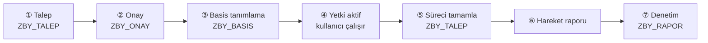

| Adım | Kim | İşlem kodu | Durum |
|:-:|---|---|---|
| ① | Kullanıcı | `ZBY_TALEP` → Yeni talep | `N` Onay bekliyor |
| ② | Onaycı | `ZBY_ONAY` | `O` Onaylandı – Basis bekliyor |
| ③ | Basis | `ZBY_BASIS` | `A` Yetki aktif (ileri tarihliyse `P` Planlandı) |
| ④ | Kullanıcı | — (normal çalışma) | `A` |
| ⑤ | Kullanıcı | `ZBY_TALEP` → Taleplerim | `T` Kullanıcı tamamladı |
| ⑥ | Kullanıcı | otomatik açılır | — |
| ⑦ | Onaycı / Basis / Denetçi | `ZBY_RAPOR` | — |

---

## ① Kullanıcı yetki talep eder – `ZBY_TALEP`

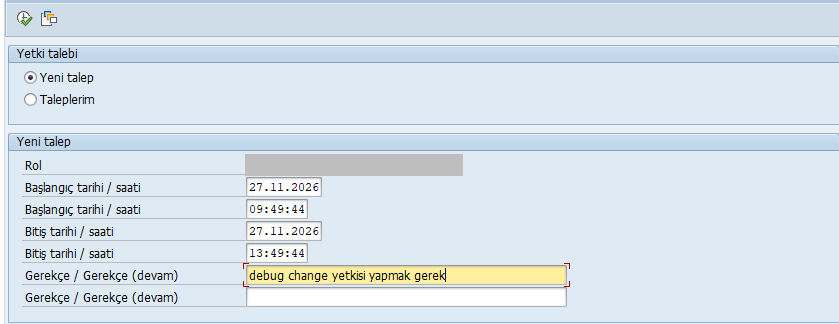

* **Yeni talep** seçilidir. Rol, parametreden gelir ve değiştirilemez.
* Başlangıç ve bitiş tarih / saati girilir. Ekran varsayılan olarak **şimdi → 4 saat sonrası** ile açılır. Süre **en fazla 24 saat** olabilir.
* **Gerekçe** zorunludur, iki satıra kadar yazılabilir.
* Çalıştır (F8) ile talep kaydedilir:
  * Sıralı **talep numarası** verilir (ticket / olay no da aynı numaradır).
  * Onaycılara e-posta gider.
  * Kullanıcının zaten açık bir talebi varsa yeni talep açılmaz.

---

## ② Onaycı talebi onaylar – `ZBY_ONAY`

**Seçim ekranı.** Boş bırakılıp çalıştırılırsa bekleyen tüm talepler listelenir. Bu ekran Onay, Basis ve Rapor işlem kodlarında ortaktır.

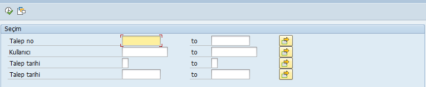

**Onay bekleyen talepler.** Satır seçilip detayına bakılabilir. Satırdaki ✔ **Onayla** veya ✖ **Reddet** ikonuna tıklanır.

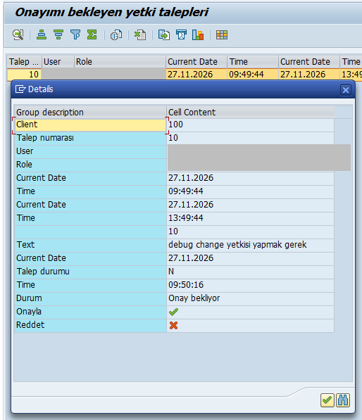

**Onay notu** isteğe bağlıdır. Reddederken gerekçe zorunludur.

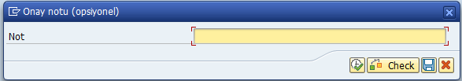

Onaydan sonra Basis ekibine e-posta gider, kullanıcı da bilgilendirilir.

> 🔒 **4 göz ilkesi:** Onaycı kendi talebini onaylayamaz.

---

## ③ Basis yetkiyi tanımlar – `ZBY_BASIS`

**Basis listesi.** Onaylanmış talepte onaycının adı ve notu görünür. Satırdaki ✏ **Yetki tanımla** ikonuna tıklanır.

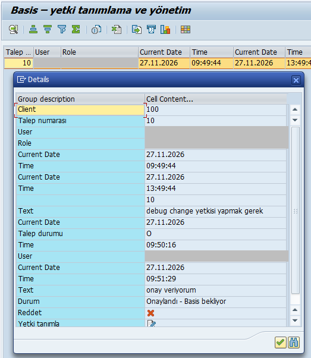

**Yetki tanımlama popup'ı.** Rol ve **kesin** tarih / saat aralığı girilir. Talep edilen aralık varsayılan olarak gelir, Basis kısaltabilir. Basis notu isteğe bağlıdır.

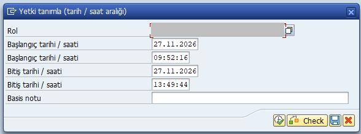

* Başlangıç zamanı geldiyse rol **hemen** atanır, durum `A` olur ve kullanıcıya "yetkiniz aktif" e-postası gider.
* Başlangıç ileri tarihliyse durum `P` olur. Job, başlangıç zamanı gelince rolü atar.
* Rol, SAP'de bitiş tarihiyle sınırlı atanır. Job çalışmasa bile yetki en geç bitiş gününün sonunda düşer.

> 🔒 Basis kendine yetki tanımlayamaz. Kullanıcı rolü zaten taşıyorsa ek atama yapılmaz ve süreç sonunda rol geri alınmaz.

---

## ④ Yetki aktif – kullanıcı çalışır

Kullanıcı `ZBY_TALEP` → **Taleplerim** ile talebini izler.

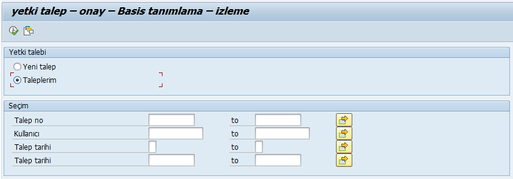

Durum **A – Yetki aktif**. Detayda talep, onay ve Basis bilgileri ile "rol atandı" mesajı görünür.

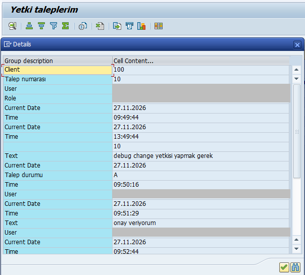

Bu süre içinde kullanıcının yaptığı her şey kayıt altındadır. Satırın sonunda iki ikon vardır:

* 🏁 **Tamamla / İptal:** İş bitince süreci kapatır.
* 📄 **Hareket raporu:** O ana kadar yapılan işlemleri gösterir.

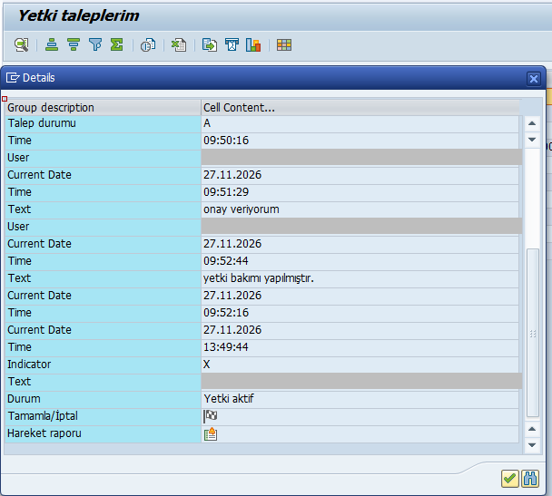

> Job her çalıştığında aktif yetkinin o ana kadarki hareketlerini kalıcı tabloya kaydeder. Böylece kısa süre saklanan STAD verileri kaybolmaz.

---

## ⑤ Kullanıcı süreci tamamlar

İş bitince 🏁 ikonuna tıklanır ve onay verilir. Süre dolmasını beklemeye gerek yoktur.

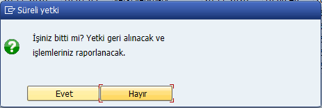

* Rol **hemen** geri alınır.
* Son hareketler toplanır, durum `T` olur.
* Kullanıcı, onaycı ve Basis'e özet e-posta gider.
* Hareket raporu ekranda açılır.

Kullanıcı tamamlamazsa job, bitiş saati gelince aynı işlemleri yapar ve durum `E` (süre doldu) olur. Basis isterse ⛔ ile erken sonlandırabilir; o zaman durum `S` olur.

---

## ⑥ Hareket raporu

Başlıkta kullanıcı, rol ve tanımlanan yetki aralığı yazar. Her satır yetki süresince yapılan bir işlemdir.

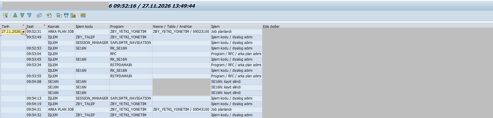

Bu örnekte rapor şunları gösteriyor:

| Kaynak | Ne görüyoruz |
|---|---|
| **İŞLEM** | Çalıştırılan işlem kodları (`ZBY_TALEP`, `SE16N`, `SESSION_MANAGER`) ve programlar. Ardışık adımlar tek satıra indirilmiştir. |
| **SE16N** | SE16N ile bir tablodan **silinen 3 kayıt**. "Eski değer" kolonunda silinen kaydın tüm alanları `ALAN=değer` olarak duruyor; ne silindiği tam olarak görülebiliyor. |
| **ARKA PLAN JOB** | Yetki süresince planlanan job'lar |

Değişiklik belgeleri, tablo logu, transport ve Security Audit Log kaynakları da varsa aynı listede kendi adlarıyla görünür. Liste standart ALV olduğu için sıralanabilir, filtrelenebilir ve Excel'e aktarılabilir.

---

## ⑦ Denetim – `ZBY_RAPOR`

Onaycı, Basis ve denetçiler (`ZBY_KULLANICI` tip `D`) tüm talepleri görür. Kullanıcılar yalnızca kendi taleplerini görür.

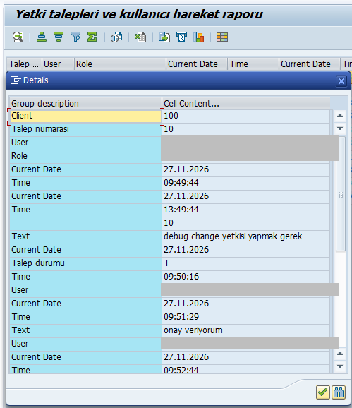

Detayın sonunda talebin tüm geçmişi tek yerde durur:

* kim, ne zaman talep etti ve hangi gerekçeyle,
* kim onayladı ve ne not düştü,
* Basis hangi aralığı tanımladı,
* rol ne zaman atandı ve ne zaman geri alındı,
* süreci kim kapattı, kaç hareket kaydedildi.

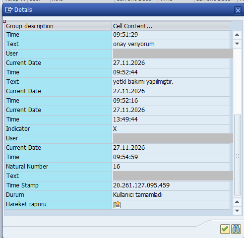

📄 **Hareket raporu** ikonu aynı raporu açar. Raporu kimin, ne zaman açtığı da `ZBY_LOG` tablosuna yazılır.

---

## Sık sorulanlar

**Talep ettiğim süreden önce işim biterse?**
Taleplerim → 🏁 ile tamamlayın. Rol hemen geri alınır.

**Süre yetmezse?**
Mevcut talebi tamamlayıp yeni bir talep açın. Bir kullanıcının aynı anda yalnızca bir açık talebi olabilir.

**Onaydan önce vazgeçersem?**
Aktif olmayan talep Taleplerim → 🗑 ile iptal edilir.

**Rapor ne kadar süre saklanır?**
Hareketler kalıcı tabloya yazıldığı için süresiz saklanır. SAP'nin kendi logları silinse bile rapor açılabilir.
