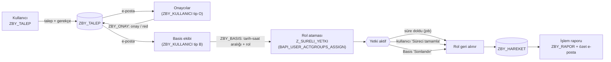

# ZBY – Teknik Doküman ve Kurulum Kılavuzu

> Proje özeti için [README](../README.md), kodun yapısı için [Kod Açıklaması](KOD_ACIKLAMASI.md).

Tamamen **bağımsız bir Z çözümüdür**. SecurityBridge veya başka bir üçüncü parti ürün gerekmez; yalnızca standart SAP fonksiyonları, BAPI'ler ve tablolar kullanılır. Bütün süreç bakım tablolarıyla yönetilir:
* kimin onaycı, kimin Basis olduğu,
* hangi rolün verileceği,
* azami süre,
* hangi kaynakların raporlanacağı,
* e-posta gönderilip gönderilmeyeceği.

## 1. Süreç ve durumlar

| Adım | İşlem kodu | Kim | Ne olur | Durum |
|---|---|---|---|---|
| 1 | `ZBY_TALEP` → Yeni talep | Yetkiye ihtiyacı olan kullanıcı (kendisi için) | Başlangıç/bitiş tarih-saati ve gerekçe girilir, ticket no otomatik verilir. **Onaycılara e-posta** gider. | `N` Onay bekliyor |
| 2 | `ZBY_ONAY` | Onaycı (`ZBY_KULLANICI` tip **O**) | ✔ Onayla (not opsiyonel) / ✖ Reddet (gerekçe zorunlu). Onayda **Basis ekibine e-posta** gider, kullanıcı bilgilendirilir. | `O` Basis bekliyor / `R` |
| 3 | `ZBY_BASIS` | Basis (`ZBY_KULLANICI` tip **B**) | Popup'ta **rol** (varsayılan `Z_SURELI_YETKI`) ve **kesin tarih/saat aralığı** girilir. Başlangıç geldiyse rol hemen atanır; ileri tarihliyse job başlangıçta atar. Basis gerekirse reddedebilir. | `P` Planlandı → `A` Aktif |
| 4a | `ZBY_TALEP` → Taleplerim → ✅ **Süreci tamamla** | Kullanıcı | Rol geri alınır, işlemler toplanır, **rapor ekranda açılır**, özet e-posta gider. | `T` Tamamlandı |
| 4b | Job | Sistem | Bitiş zamanı gelen yetki geri alınır, rapor hazırlanır, özet e-posta gider. | `E` Süre doldu |
| 4c | `ZBY_BASIS` → ⛔ Sonlandır | Basis | Yetki erken geri alınır (planlı bir yetki de iptal edilebilir). | `S` |
| — | `ZBY_TALEP` → Taleplerim → 🗑 | Kullanıcı | Aktif olmayan talebini iptal eder. | `C` |
| 5 | `ZBY_RAPOR` (veya listelerdeki 📄) | Kullanıcı (yalnızca kendi talepleri), onaycı / Basis / denetçi (tümü) | Yetki süresince yapılan işlemlerin raporu. | — |

**Kontroller:**
* **4 göz ilkesi:** Kullanıcı kendi talebini onaylayamaz. Basis kullanıcısı kendine yetki tanımlayamaz.
* Bir kullanıcının aynı anda yalnızca **bir** açık talebi olabilir.
* Talep süresi ve Basis'in tanımladığı süre **en fazla 24 saattir**. `ZBY_PARAM-MAKS_SAAT` ile bu süre kısaltılabilir ama 24 saatin üstüne çıkarılamaz.
* Ticket / olay no elle girilmez. Talep numarasıyla aynı sıralı numara (1, 2, 3 …) otomatik verilir.
* Rol, `FROM_DAT`/`TO_DAT` ile tarih sınırlı atanır. Job çalışmasa bile yetki **en geç bitiş gününün sonunda** standart SAP tarafından düşer. Job ise saat ve dakika hassasiyetinde geri alır.
* Kullanıcı rolü zaten taşıyorsa ek atama yapılmaz ve rol geri alınmaz. Geri alırken yalnızca bu talebin eklediği satır silinir (eşleştirme: rol + başlangıç tarihi + bitiş tarihi).
* Her adım `ZBY_LOG` tablosuna yazılır. Raporu kimin ne zaman açtığı da kaydedilir.

## 2. Raporlanan işlemler (standart kaynaklar)

| Kaynak (rapordaki adı) | Standart kaynak | İçerik | Parametre |
|---|---|---|---|
| **İŞLEM** | İş yükü istatistikleri (STAD): `SWNC_STAD_READ_STATRECS` | Çalıştırılan işlem kodları ve programlar, terminal. Aynı işlem kodundaki ardışık diyalog adımları tek satıra indirilir. | `KAYNAK_STAD` |
| **DEĞ.BELGESİ** | `CHANGEDOCUMENT_READ_RANGES` (CDHDR/CDPOS) | Kullanıcı/rol değişiklikleri (SU01/PFCG), ana veri ve belge değişiklikleri: tablo, anahtar, alan, **eski/yeni değer** | `KAYNAK_CD` |
| **TABLO LOG** | `DBTABLOG` | Tablo loglaması açık tablolarda (SM30/SE16N/customizing) ekleme/değişiklik/silme. Alan detayı SCU3'te. | `KAYNAK_TABLOG` |
| **ARKA PLAN JOB** | `TBTCO` / `TBTCP` | Kullanıcının planladığı job'lar ve kullanıcı adına çalışan job adımları | `KAYNAK_JOB` |
| **TRANSPORT** | `E070` / `E07T` | Kullanıcının oluşturduğu, değiştirdiği veya serbest bıraktığı transport talepleri | `KAYNAK_TRANSPORT` |
| **SE16N** | `SE16N_CD_KEY` / `SE16N_CD_DATA` (RKSE16N_CD_DISPLAY) | SE16N ile eklenen/değiştirilen/silinen kayıtlar; kayıt içeriği `ALAN=değer` olarak | `KAYNAK_SE16N` |
| **AUDIT LOG** | `RSAU_SELECT_EVENTS` (SM20), ALV verisi `CL_SALV_BS_RUNTIME_INFO` ile alınır | Oturum açma, işlem/program başlatma, RFC, kullanıcı yönetimi vb. olaylar. Yetki: `S_ADMI_FCD`=`AUDD` | `KAYNAK_AUDIT` |

**Artımlı toplama:** STAD verileri sistemde kısa süre saklanır (varsayılan ~48 saat, `stat/max_files`). Bu yüzden job her çalıştığında aktif yetkilerin o ana kadarki hareketlerini `ZBY_HAREKET` tablosuna kaydeder. Yetki bittiğinde kalan kısım toplanır ve rapor kalıcı hale gelir; yani aylar sonra bile görüntülenebilir. Pencere `[son toplama, şimdi)` mantığıyla çalıştığı için aynı kayıt iki kez yazılmaz.

**Security Audit Log (SM20/SM20N):** `RSAU_SELECT_EVENTS`, kullanıcı / istemci / tarih-saat aralığıyla `SUBMIT ... AND RETURN` ile çalıştırılır. ALV ekrana basılmaz; sonuç tablosu `CL_SALV_BS_RUNTIME_INFO` ile alınır. `S_ADMI_FCD = AUDD` yetkisi yoksa kaynak atlanır ve `ZBY_LOG`'a `TOPLAMA_UYARI` yazılır.

## 3. DDIC nesneleri (SE11)

### 3.1 Domain / veri elemanları

| Nesne | Tanım |
|---|---|
| `ZBY_REQ_ID` | Veri elemanı, NUMC 10, “Talep No” |
| `ZBY_STATUS` | Domain + veri elemanı, CHAR 1, sabit değerler: `N` Onay bekliyor, `O` Onaylandı-Basis bekliyor, `P` Planlandı, `A` Yetki aktif, `T` Kullanıcı tamamladı, `E` Süre doldu, `S` Basis sonlandırdı, `R` Reddedildi, `C` İptal edildi |
| `ZBY_USER_TYPE` | Domain + veri elemanı, CHAR 1, sabit değerler: `O` Onaycı, `B` Basis, `D` Denetçi (yalnızca rapor) |

### 3.2 `ZBY_TALEP` – Talepler (teslimat sınıfı A)

| Alan | Anahtar | Veri elemanı / tip | Açıklama |
|---|:-:|---|---|
| MANDT | X | MANDT | |
| REQ_ID | X | ZBY_REQ_ID | Talep no |
| BNAME | | XUBNAME | Talep eden = yetkiyi alacak kullanıcı |
| AGR_NAME | | AGR_NAME | Rol (varsayılan `Z_SURELI_YETKI`) |
| REQ_FROM_DATE / REQ_FROM_TIME | | SYDATUM / SYUZEIT | İstenen başlangıç |
| REQ_TO_DATE / REQ_TO_TIME | | SYDATUM / SYUZEIT | İstenen bitiş |
| TICKET | | TEXT40 | Ticket / olay no |
| REASON | | TEXT255 | Gerekçe |
| STATUS | | ZBY_STATUS | Durum |
| CR_DATE / CR_TIME | | SYDATUM / SYUZEIT | Talep zamanı |
| APPROVER | | XUBNAME | Onaycı |
| APPR_DATE / APPR_TIME | | SYDATUM / SYUZEIT | |
| APPR_NOTE | | TEXT255 | Onay notu / red gerekçesi |
| BASIS_USER | | XUBNAME | Tanımlayan Basis |
| BASIS_DATE / BASIS_TIME | | SYDATUM / SYUZEIT | |
| BASIS_NOTE | | TEXT255 | Basis notu |
| VALID_FROM_DATE / VALID_FROM_TIME | | SYDATUM / SYUZEIT | **Tanımlanan** başlangıç |
| VALID_TO_DATE / VALID_TO_TIME | | SYDATUM / SYUZEIT | **Tanımlanan** bitiş |
| ROLE_PREEXIST | | FLAG | Rol önceden vardı |
| ROLE_ASSIGNED | | FLAG | Rolü bu süreç atadı (geri alınacak) |
| ENDED_BY | | XUBNAME | Sonlandıran (job'da job kullanıcısı) |
| ENDED_DATE / ENDED_TIME | | SYDATUM / SYUZEIT | |
| COLLECTED_TS | | TIMESTAMP | Hareketlerin toplandığı son an (sistem saati, YYYYMMDDhhmmss) |
| ACT_COUNT | | INT4 | Kaydedilen hareket sayısı |
| LAST_MSG | | TEXT255 | Son işlem mesajı |

İkincil indeks önerisi: `STATUS` (job seçimi için), `BNAME`.

### 3.3 `ZBY_HAREKET` – Raporlanan işlemler (teslimat sınıfı A)

| Alan | Anahtar | Tip | Açıklama |
|---|:-:|---|---|
| MANDT | X | MANDT | |
| REQ_ID | X | ZBY_REQ_ID | |
| SEQ | X | INT4 | Sıra |
| DATUM | | SYDATUM | Tarih |
| UZEIT | | SYUZEIT | Saat |
| SOURCE | | CHAR 15 | Kaynak |
| TCODE | | TCODE | İşlem kodu |
| PROG_NAME | | PROGNAME (CHAR 40) | Program |
| OBJECT | | CHAR 120 | Nesne / tablo / anahtar |
| ACTION | | CHAR 60 | İşlem |
| OLD_VALUE | | TEXT255 | Eski değer |
| NEW_VALUE | | TEXT255 | Yeni değer |
| TEXT | | TEXT255 | Açıklama |
| TERMINAL | | CHAR 20 | Terminal |

### 3.4 `ZBY_KULLANICI` – Onaycı / Basis / Denetçi (teslimat sınıfı C, SM30)

| Alan | Anahtar | Tip | Açıklama |
|---|:-:|---|---|
| MANDT | X | MANDT | |
| BNAME | X | XUBNAME | SAP kullanıcısı |
| USER_TYPE | X | ZBY_USER_TYPE | `O` Onaycı, `B` Basis, `D` Denetçi |
| EMAIL | | AD_SMTPADR | E-posta (boşsa SU01 e-postası; o da yoksa kullanıcıya e-posta gitmez) |
| ACTIVE | | FLAG | Aktif (yalnızca işaretli kayıtlar kullanılır) |

Bir kullanıcı birden fazla tipte tanımlanabilir. Örneğin bir kullanıcı hem `O` hem `D` olabilir.

### 3.5 `ZBY_PARAM` – Parametreler (teslimat sınıfı C, SM30)

| Alan | Anahtar | Tip |
|---|:-:|---|
| MANDT | X | MANDT |
| PARAM | X | CHAR 30 |
| VALUE | | CHAR 255 |
| DESCRIPTION | | TEXT60 |

| PARAM | Varsayılan (kayıt yoksa) | Anlamı |
|---|---|---|
| `ROL` | `Z_SURELI_YETKI` | Talepte önerilen / atanan rol (Basis popup'ta değiştirebilir) |
| `MAKS_SAAT` | `24` | Talep ve tanımlamada izin verilen en uzun süre (saat). Üst sınır 24; daha büyük değerler 24 sayılır |
| `EPOSTA` | `X` | `X` = e-posta gönder, boş = gönderme |
| `KAYNAK_STAD` | `X` | İşlem kodu/program raporlama |
| `KAYNAK_CD` | `X` | Değişiklik belgeleri |
| `KAYNAK_TABLOG` | `X` | Tablo logu |
| `KAYNAK_JOB` | `X` | Arka plan job'ları |
| `KAYNAK_TRANSPORT` | `X` | Transport talepleri |
| `KAYNAK_SE16N` | `X` | SE16N tablo değişiklikleri |
| `KAYNAK_AUDIT` | `X` | Security Audit Log (SM20) |
| `MAIL_GONDEREN` | boş | E-posta gönderen adresi. Boşsa SAP, çalıştıran kullanıcının (job'da job kullanıcısının) adresini kullanır; bu kullanıcının e-postası yoksa gönderim hata verir |

### 3.6 `ZBY_LOG` – Denetim izi (teslimat sınıfı A)

| Alan | Anahtar | Tip |
|---|:-:|---|
| MANDT | X | MANDT |
| REQ_ID | X | ZBY_REQ_ID |
| LOG_TS | X | TIMESTAMPL |
| UNAME | | XUBNAME |
| ACTION | | CHAR 20 |
| MSG | | TEXT255 |

Kaydedilen aksiyonlar: `TALEP`, `ONAY`, `RED`, `PLANLANDI`, `AKTIF`, `ATAMA_HATA`, `IPTAL`, `DURDUR`, `BITIS`, `GERIALMA_HATA`, `TOPLAMA_UYARI`, `RAPOR`.

## 4. Kurulum

1. Bölüm 3'teki DDIC nesnelerini oluşturun. `ZBY_KULLANICI` ve `ZBY_PARAM` için **Table Maintenance Generator** ile SM30 bakım ekranlarını üretin. İsterseniz SE93'te `ZBY_BAKIM` gibi parametre işlem kodları da tanımlayabilirsiniz.
2. SE38 → `ZBY_YETKI_YONETIM` programını oluşturun, `ZBY_YETKI_YONETIM.abap` içeriğini yapıştırın, aktive edin.
3. **Seçim metinleri** (Goto → Text elements → Selection texts):

   | Ad | Metin | Ad | Metin |
   |---|---|---|---|
   | RB_TLP | Yetki talebi | P_ROLE | Rol |
   | RB_ONAY | Onay | P_FRD / P_FRT | Başlangıç tarihi / saati |
   | RB_BAS | Basis tanımlama | P_TOD / P_TOT | Bitiş tarihi / saati |
   | RB_RAP | Rapor | | |
   | RB_JOB | Arka plan job | P_REAS1 / P_REAS2 | Gerekçe / Gerekçe (devam) |
   | RB_NEW | Yeni talep | S_REQID / S_BNAME | Talep no / Kullanıcı |
   | RB_MY | Taleplerim | S_STAT / S_CRDAT | Durum / Talep tarihi |
   | P_TEST | Test modu | P_GROLE | Rol |
   | P_GFD / P_GFT | Başlangıç tarihi / saati | P_GTD / P_GTT | Bitiş tarihi / saati |
   | P_GNOTE | Basis notu | P_NOTE | Not |

4. **İşlem kodları (SE93)**, hepsi “Program and selection screen (report transaction)”, program `ZBY_YETKI_YONETIM`, ekran `1000`. Program, mod seçimini işlem koduna göre yapar:

   | İşlem kodu | Kullanıcı | Açıklama |
   |---|---|---|
   | `ZBY_TALEP` | Tüm kullanıcılar | Yeni talep + Taleplerim (tamamla / iptal / rapor) |
   | `ZBY_ONAY` | Onaycılar | Onay bekleyen talepler |
   | `ZBY_BASIS` | Basis ekibi | Tanımlama, red, erken sonlandırma |
   | `ZBY_RAPOR` | Onaycı / Basis / Denetçi (+ kullanıcı kendi talepleri) | Talep ve hareket raporu |

5. **Job (SM36):** `ZBY_YETKI_YONETIM` için “Arka plan job” modunda bir varyant kaydedin ve **her 5–15 dakikada** bir çalışacak şekilde planlayın. Arka planda program her zaman job modunda çalışır. Job, üç iş yapar:
   * planlanan yetkileri başlangıçta aktif eder,
   * süresi dolanları geri alır,
   * aktif yetkilerin hareketlerini artımlı olarak toplar.
6. **E-posta:** SCOT/SOST'ta SMTP yapılandırılmış olmalıdır. Gönderimler `SOST`'tan izlenebilir.
7. `ZBY_KULLANICI` tablosuna onaycı ve Basis kullanıcılarını girin. `ZBY_PARAM` tablosunda gerekirse `ROL`, `MAKS_SAAT` vb. değerleri değiştirin.
8. Rol (`Z_SURELI_YETKI`) PFCG'de **profili üretilmiş** olarak mevcut olmalıdır. Program, Basis tanımlamasında rolün varlığını kontrol eder.

## 5. Yetkiler

| Kim | Gerekli yetki |
|---|---|
| Tüm kullanıcılar | `S_TCODE`: `ZBY_TALEP` |
| Onaycı | `S_TCODE`: `ZBY_ONAY`, `ZBY_RAPOR` + `ZBY_KULLANICI` kaydı (tip O) |
| Basis | `S_TCODE`: `ZBY_BASIS`, `ZBY_RAPOR` + `ZBY_KULLANICI` kaydı (tip B) + kullanıcı yönetimi: `S_USER_GRP` (ACTVT 02, 03), `S_USER_AGR` (ACTVT 22, ilgili rol için), gerekirse `S_USER_PRO` (22) |
| Rapor görüntüleyenler | Aktif yetkinin raporunda canlı STAD okuması için `S_TOOLS_EX` (`AUTH = S_TOOLS_EX_A`) gerekir. Yetki yoksa yalnızca job'ın daha önce topladığı kayıtlar görünür. |
| Job kullanıcısı | Kullanıcı yönetimi (Basis ile aynı), `S_TOOLS_EX`, `CDHDR`/`DBTABLOG`/`TBTCO`/`E070` okuma, e-posta gönderimi |

> **Not:** Bu çözümde rol atamasını programın kendisi yapar; onay mantığı Z tablolarıyla yönetilir. Basis kullanıcısının PFCG/SU01 yetkisi yoksa yetki tanımlama adımı hata verir (`LAST_MSG` / `ZBY_LOG`). Daha sıkı bir kurgu için rol atamasını yalnızca job kullanıcısı yapacak şekilde düzenlemek mümkündür. Bu durumda Basis yalnızca aralığı planlar, atamayı job yapar.

## 6. Bilinen sınırlamalar

* **Tek sistem:** Rol ataması ve işlem raporu, programın çalıştığı sistem/istemci için yapılır. Birden çok sisteme yönelik kullanım için her sisteme kurulmalıdır. RFC ile merkezi kurgu ayrı bir geliştirmedir.
* **Rol listesi:** `BAPI_USER_ACTGROUPS_ASSIGN` kullanıcının tüm rol listesini yeniden yazar. Program önce listeyi okuyup yalnızca kendi satırını ekler veya çıkarır. CUA kullanılan sistemlerde roller merkezi sistemden yönetildiği için uyarlama gerekir.
* **Saat hassasiyeti:** SAP rol ataması gün bazındadır. Saat bazında başlatma ve bitirme job tarafından yapılır, dolayısıyla doğruluk job sıklığına (5–15 dk) bağlıdır.
* **STAD saklama süresi:** Job düzenli çalışmazsa ve yetki STAD saklama süresinden uzun sürerse, en eski işlem adımları kaybolabilir. Değişiklik belgeleri, tablo logu, job ve transport bilgileri etkilenmez.
* **Değişiklik belgeleri:** Tüm nesne sınıflarında arama, büyük sistemlerde CDHDR üzerinde yavaş olabilir. Gerekirse `KAYNAK_CD` kapatılabilir veya `READ_CHANGEDOCS` metodunda `objectclass_tab` belirli sınıflarla (`IDENTITY`, `PFCG`, `MATERIAL`, …) sınırlandırılabilir.
* **Tablo logu:** Yalnızca `rec/client` açık ve tablo loglaması aktif tablolar için veri gelir. Alan bazında eski/yeni değer için SCU3 kullanılmalıdır.
* **Zaman:** Tüm zamanlar uygulama sunucusunun sistem saatiyle hesaplanır.

## 7. Test senaryosu

1. `ZBY_KULLANICI`: A = normal kullanıcı (kayıt yok), O1 = tip `O`, B1 = tip `B`. `ZBY_PARAM`: `MAKS_SAAT = 4`.
2. **A** → `ZBY_TALEP` → Yeni talep: bugün 14:00–16:00, gerekçe girilir. O1'e e-posta gider (SOST'ta kontrol edin).
3. **O1** → `ZBY_ONAY` → ✔ Onayla. B1'e e-posta gider, durum `O` olur.
4. **B1** → `ZBY_BASIS` → ✏ Yetki tanımla: rol `Z_SURELI_YETKI`, aralığı onaylayın.
   * Başlangıç geçmişse rol hemen atanır (`A`); SU01'de A kullanıcısında rol görünmelidir.
   * Başlangıç ileri tarihliyse durum `P` olur ve job başlangıçta rolü atar.
5. **A** birkaç işlem yapar: SU01 görüntüleme, SM30 ile bir tablo değişikliği, SE16, bir job planlama.
6. **A** → `ZBY_TALEP` → Taleplerim → ✅ Süreci tamamla.
   * Rol kalkar, rapor ekranda açılır, A / O1 / B1'e özet e-posta gider.
7. **O1** → `ZBY_RAPOR` → talep satırında 📄 → aynı rapor. `ZBY_LOG` tablosunda `RAPOR` kaydı oluşur.
8. Job testi: yeni bir talebi 15 dakikalık süreyle tanımlayın.
   * Job'ı önce `P_TEST` açık çalıştırın (yalnızca listeler).
   * Süre dolunca test modu kapalı çalıştırın: durum `E` olmalı ve rapor oluşmalıdır.
